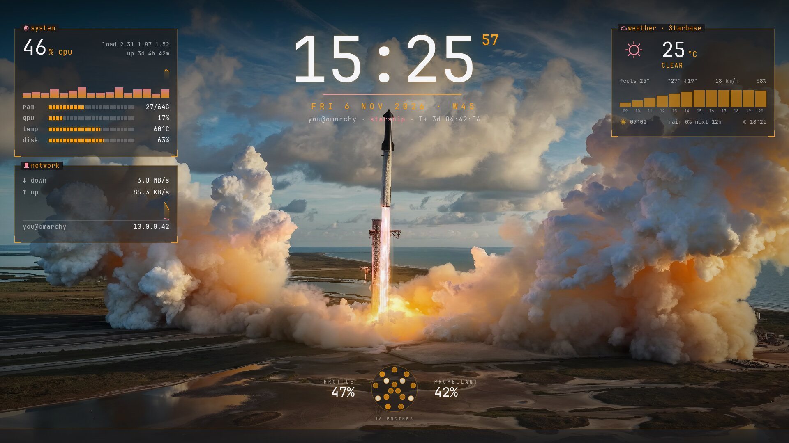
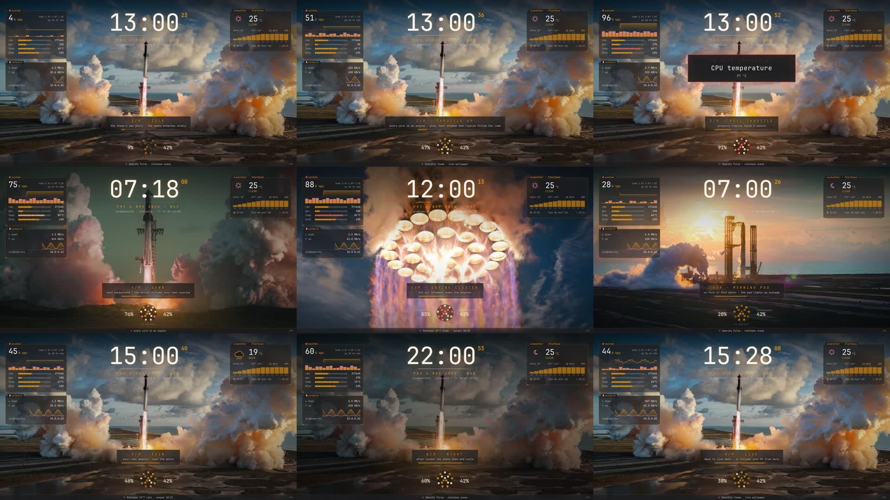

# Omarchy Pulse · Starbase

A live wallpaper for [Omarchy](https://omarchy.org)'s **Starship** theme. The theme's own launch photos come alive,
driven by your PC: the harder it works, the harder the engines burn.



It is a scene for [Omarchy Pulse](https://github.com/piermark/omarchy-pulse-theme) by Marco Porro, and this repo ships
Pulse with it, so one install gives you the whole live wallpaper: Pulse's panels (system, network, weather and any
data you add) over the Starship photo.

## What moves

The photo stays a photo. Only the parts that would really move do, and the rocket and tower never wobble.

| On the wallpaper | Is your |
|---|---|
| the flame glows brighter and wider, the smoke around the pad lights up | CPU load |
| heat shimmer over the flame, streaks running down the exhaust | CPU load |
| the smoke slowly billows; pressure ripples roll out through it, faster under load (a heartbeat) | CPU load |
| the engine ring under the pad: one circle per core, white-hot, red above 90 % | each CPU core |
| propellant, next to the ring | RAM |
| dimmer and cooler after sunset, warmer at sunrise and sunset, flatter when grey | your real sun and weather |
| rain, snow or fog over the photo | your real weather |
| `HOLD HOLD HOLD` and a red tint | a Pulse alert (CPU too hot, a source crossing its limit...) |
| `T+ 3d 04:17:09` under the clock | uptime |

It follows Omarchy's next-background key: all four Starship photos (the launch, the dawn launch, the engine
cluster, the morning pad) know where their fire and smoke are. On other photos only the colours and the weather
change. At idle the motion is slow and faint: the smoke breathes, a ripple every few seconds.



## Install

On Omarchy 4.5 or newer, from a terminal on the PC itself (not over SSH):

```bash
git clone https://github.com/jkjoplin/omarchy-pulse-starbase
cd omarchy-pulse-starbase
./install.sh
omarchy theme set starship     # if you are not on it already
```

The installer adds what is missing (`python-gobject`, `gtk-layer-shell`, `webkit2gtk-4.1`, `ffmpeg`, `playerctl`,
through `sudo pacman`), asks your city for the weather, and starts the wallpaper. From then on it starts at login
whenever the theme is Starship (or pulse), and stops with any other theme.

- Live with every theme (the others get Pulse's own scenes in their colours): `./install.sh --always`
- Remove it: `./install.sh --remove`

If you already had Omarchy Pulse (from the pulse theme), the installer moves it aside first, and `--remove` puts it
back. Your `~/.config/omarchy-pulse/pulse.toml` is kept either way.

## See it

- Switch to an empty workspace: windows on top make the wallpaper calm down (8 fps), full-screen apps pause it.
- A 2-minute tour of everything above, in a browser:
  ```bash
  xdg-open "http://127.0.0.1:47800/?token=$(cat ~/.config/omarchy-pulse/token)&tour=1"
  ```
- Preview settings on the same URL: `&cpu=80` (pretend load), `&demo=1` (load ramps up and down), `&tod=21.5`
  (hour of the day), `&wx=rain` (rain, snow, fog, storm), `&bg=3-engine-cluster` (another Starship photo),
  `&dbg=mask` (show what moves: red smoke, green plume, blue rigid), `&gl=0` (no WebGL: still photo plus glow).

## Make it yours

Everything is in `~/.config/omarchy-pulse/pulse.toml` and is picked up a few seconds after you save it. Every
`[[source]]` becomes a panel: commands, URLs, files, streams, cameras, anything you push with `omarchy-pulse push`.
Pulse's [guide](https://github.com/piermark/omarchy-pulse-theme/blob/main/docs/GUIDE.md) covers all of it.

Starbase adds one setting, the scene for each theme:

```toml
[pulse]
scenes = { starship = "starbase" }   # the default; "launchpad" is a drawn version of the same idea
```

## Record your own video

Demo data shows a made-up PC (`you@omarchy`, 10.0.0.42, sunny Starbase) instead of yours: no names, repos or
notifications.

```bash
PULSE_PORT=47801 PULSE_DEMO_SCENE=starbase omarchy-pulse serve --demo
# then open http://127.0.0.1:47801/?token=$(cat ~/.config/omarchy-pulse/token)&tour=1&fps=30 and record it
```

## Cost

Measured on a 16" MacBook Pro (i9, Radeon 5500M) at 3072×1920 with windows open: about 27 % of one core with the
moving photo. That is less than Pulse's own skyline scene (about 42 %) on the same machine. `&gl=0`, the still photo
plus glow, uses about 13 %. On battery Pulse lowers the frame rate by itself.

## What changed from Omarchy Pulse

- new: the `starbase` scene (`web/starbase.js`, `web/photo-gl.js`, `web/engine-ring.js`) and `launchpad`, a drawn
  version (`web/launchpad.js`); small hooks in `web/pulse.js` so a scene can live in its own file
- new: `/bg` on the local hub serves the current Omarchy background (scaled once with ffmpeg, cached in
  `~/.cache/omarchy-pulse`); `scenes = { theme = "scene" }` in `pulse.toml`; `pulse-live` is also live with Starship
- fixed: theme colours now come from `~/.local/state/omarchy/current/theme` (where Omarchy 4.5 puts them) and from the
  named keys of stock themes (`red`, `cyan`, `muted`...), so Pulse follows Omarchy's own themes
- fixed: the demo CPU could go below zero; new `PULSE_DEMO_SCENE=starbase` demo profile

## Credits

[Omarchy Pulse](https://github.com/piermark/omarchy-pulse-theme) is by [Marco Porro](https://x.com/MarcoPorro): the
engine, the panels and everything that makes the data live. The Starship photos come with Omarchy's Starship theme
and are not part of this repo: the scene reads them from your own install. Not affiliated with SpaceX or Omarchy.

MIT, see [LICENSE](LICENSE).
